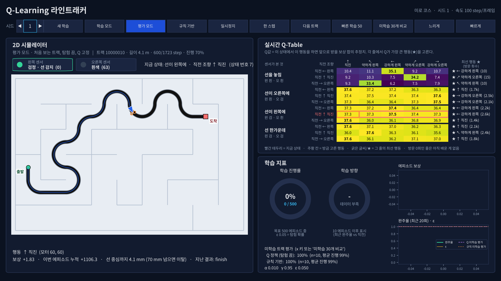

# Why Q-Learning Fails: Instability Analysis on a 2D Line Follower

> **Tabular Q-learning을 실전 제어에 그대로 쓰기 어려운 이유는 무엇일까요?**

2D 라인트래커에서 규칙 기반 정책이 모두 완주한 평가 미로 30개를 사용해, Tabular Q-learning의 완주율을 학습 시드와 중단 시점별로 비교했습니다. 같은 시드에서도 학습을 멈춘 시점에 따라 코너에서 선택하는 조향이 바뀌고, 완주하던 정책이 이탈할 수 있음을 확인했습니다.이 사례는 학습된 주행 정책을 실전에 적용할 때, 한 시점의 높은 완주율만으로 정책의 안정성을 판단하기 어렵다는 점을 보여줍니다.



---

### 핵심 요약
* **현상:** 기준 설정($\gamma=0.95$, 500 에피소드, 시드 10개)에서 9개 시드는 처음 보는 미로 30개를 100% 완주했지만, `seed 7`만 0%로 이탈했습니다.
* **원인 추적:** `seed 7`은 코너 진입 상태의 강하게/약하게 조향 Q값 차이가 **0.004(사실상 동점)**에 불과해 학습 막바지에도 최선 행동(★)이 계속 뒤집혔습니다. 같은 시드도 480·490회에서 멈추면 100%, 499·500회면 0%였습니다.
* **가설 반증 ($\gamma$ · 학습 길이):** 할인율($\gamma$)을 올리거나(0.99) 내리고(0.90), 학습을 2000회까지 늘려도 불안정성은 해결되지 않았으며, 오히려 학습 길이에 따라 $\gamma$ 간 순위가 뒤집혔습니다.

---

## 1. 환경 설계 및 평가 기준

규칙 기반 정책은 미로 코스에서 항상 100% 완주하며, "정답이 확실히 존재하는 문제에서도 학습이 불안정할 수 있다"는 기준선(Baseline)으로 사용합니다.

| 항목 | 설정 |
|---|---|
| **로봇** | 2바퀴 차동구동($L=0.10\text{ m}$, 평균 속도 $0.12\text{ m/s}$, $dt=0.05\text{ s}$) + 전방 컬러 센서 2개(반사광 0=검정, 100=흰색) |
| **트랙 (`MazeTrack`)** | 9×6 격자 무작위 DFS 미로 속 한 갈래 길 |
| **상태 (12개)** | (왼쪽 센서: 검정/흰색 · 오른쪽 센서: 검정/흰색 · 직전 조향: 좌/직진/우) → 2 × 2 × 3 = 12가지 |
| **행동 (5개)** | 직진 (60, 60), 약좌 (40, 60), 강좌 (20, 60), 약우 (60, 40), 강우 (60, 20). 각 쌍은 (왼쪽, 오른쪽) 모터 출력 설정값이며, 바퀴 하나의 출력값 60은 바퀴 속도 0.12 m/s에 해당합니다. |
| **보상 (스텝당)** | 완주 +50점 / 이탈 −20점 / 주행 중 −0.05점 (cost per step), +2 × 중심도 점 (전진 시), −1점 (좌우 조향 즉시 반전 시) |
| **기준 하이퍼파라미터** | $\alpha: 0.1 \to 0.01$ (400회 감쇠), $\gamma: 0.95$, $\varepsilon: 1.0 \to 0.05$ (300회 감쇠) |
| **평가 원칙** | 학습에 쓰지 않은 **처음 보는 트랙 30개**(`seed 10,000,000`~)에서 **탐험을 끄고($\varepsilon=0$)** 시드 10개 평균·분포 측정 |

**보상 설계.** 완주에는 +50점, 이탈에는 −20점을 주어 주행 결과를 구분합니다. 주행 중에는 스텝마다 0.05점을 차감하고, 트랙을 따라 전진한 스텝에는 중심선에 가까울수록 최대 2점을 더합니다. 중심도는 중심선에서 1이며 이탈 경계에 가까워질수록 0까지 선형으로 줄어듭니다. 좌우 조향을 연속된 두 스텝에서 바로 뒤집으면 1점을 차감해 급격한 방향 전환을 줄이도록 유도합니다. 완주·이탈 스텝에는 해당 종료 보상만 적용됩니다.

### Q-Learning 업데이트

상태 **s**에서 행동 **a**를 실행해 즉시 보상 **r**을 받고 다음 상태 **s′**에 도달하면, Q-table의 해당 값을 갱신합니다.

```math
Q(s,a) \leftarrow Q(s,a) + \alpha \left[r + \gamma \max_{a'} Q(s',a') - Q(s,a)\right]
```

**α(학습률)**는 새 목표값을 얼마나 반영할지 정하고, **γ(할인율)**는 다음 상태에서 가장 높은 행동 가치에 얼마나 비중을 둘지 정합니다. **r(즉시 보상)**은 위 보상 규칙에 따라 환경이 계산합니다. 완주하거나 이탈하면 다음 상태 가치를 빼고 즉시 보상만 목표값으로 사용합니다.


---

## 2. 실패 해부: 왜 `seed 7`만 0%였는가?

기준 실험($\gamma=0.95$, 500회)에서 유일하게 0%를 기록한 `seed 7`의 Q-table과 평가 주행을 추적한 결과는 다음과 같습니다.

1. **물리적 한계를 넘는 행동 선택:** `seed 7`은 30개 평가 트랙 모두에서 `'선이 오른쪽에 · 직전 →'` 상태일 때 `'약하게 오른쪽'`을 골라 첫 오른쪽 코너에서 이탈했습니다. `'약하게 오른쪽'`의 회전 반경은 $0.25\text{ m}$로, 미로 코너 반지름($0.15\text{ m}$)보다 커서 물리적으로 코너를 돌 수 없습니다.
2. **선을 놓친 뒤 복귀 실패** — `seed 7`은 ‘두 센서가 모두 흰색이고 직전 조향이 오른쪽’인 상태에서 약하게 왼쪽으로 꺾었습니다. 이후 선을 다시 찾지 못하고 이탈했습니다.
3. **근소한 Q값 차이와 학습 중단 시점 의존성** — `seed 7`의 코너 진입 상태에서 강한 우회전과 약한 우회전 사이의 최종 Q값 차이는 약 **0.004**였습니다. 탐험을 끈 평가에서는 Q값이 가장 높은 행동을 선택합니다. 같은 학습에서 **480·490회에는 강한 우회전을 선택해 30개 모두 완주했고, 499회에는 직진, 500회에는 약한 우회전을 선택해 각각 0개를 완주했습니다.**


한 번의 연속 학습으로 이 결과를 재현하려면 `python reproduce_checkpoints.py`를 실행합니다. 각 시점의 Q-table과 난수 상태를 복사해 같은 트랙 30개에서 평가합니다. [체크포인트별 결과](results/seed7-checkpoints/summary.json) · [트랙별 평가 기록](results/seed7-checkpoints/evaluation.csv)

---

## 3. 가설 검증과 반증

`seed 7`의 실패를 관찰한 뒤 할인율과 학습 길이를 바꿔 완주율을 비교했습니다. 각 설정은 학습 시드 10개와 공통 평가 트랙 30개를 사용했습니다. 규칙 기반 정책은 이 평가 트랙 30개를 모두 완주했습니다.

### 실험 결과 요약

> **기준 설정을 잡은 이유** — 보상 설계를 다듬을 때 사용한 기본 할인율이 γ = 0.95였고, 같은 설정의 500회 학습에서 `seed 7`의 실패를 관찰해 이 조건을 후속 실험의 비교 기준으로 삼았습니다.

[설정별 원자료와 재현 명령](results/README.md)

| 구분 | 설정 | Q 평균 완주율 | 90% 이상 시드 | 평균 진행률 | 흔들림 합계* | 결과 해석 |
|---|---|---:|---:|---:|---:|---|
| 기준 | $\gamma=0.95$, $\alpha \to 0.01$, 500회 | 90.0% | 9 / 10 | 91.3% | 75 | `seed 7`만 0% |
| $\gamma$ 상향 | $\gamma=0.99$, $\alpha \to 0.01$, 500회 | 50.0% | 5 / 10 | 56.6% | 506 | 가설 기각 (악화) |
| $\gamma$ 하향 | $\gamma=0.90$, $\alpha \to 0.01$, 500회 | 40.0% | 4 / 10 | 47.3% | 186 | 악화 |
| 길이 연장 A | $\gamma=0.99$, $\alpha \to 0.01$, 2000회 | 67.7% | 6 / 10 | 72.6% | 133 | 일부 개선되나 불안정 |
| 길이 연장 B | $\gamma=0.95$, $\alpha \to 0.01$, 2000회 | 40.0% | 4 / 10 | 45.0% | 156 | 가설 기각 (순위 역전) |

*\* **흔들림 합계:** 상태 `'선이 오른쪽에 · 직전 →'`에서 마지막 100 에피소드 중 최선 행동(★)이 `'강하게 오른쪽'`이 아니었던 횟수의 시드 10개 합계.*\
*\* **평균 진행률 상한:** 완주한 주행도 완주 판정 거리 때문에 99.4%로 기록되며, 규칙 기반도 99.4%입니다.*\

### 할인율과 학습 길이 비교
* 할인율 변경으로 실패를 줄일 수 있는지 확인했습니다. 500회 학습에서 평균 완주율은 γ = 0.95에서 90.0%, γ = 0.99에서 50.0%, γ = 0.90에서 40.0%였습니다.
* 학습을 2000회로 늘렸을 때 $\gamma=0.99$는 67.7%로 일부 올랐지만, **기존에 90.0%였던 $\gamma=0.95$는 오히려 40.0%로 떨어지며 $\gamma$ 간 순위가 역전됐습니다**.

---

## 4. 결과 정리 및 시사점

**질문** — 같은 주행 환경에서 학습 시드와 학습을 멈추는 시점에 따라 완주율은 어떻게 달라졌는가?

**결론** — 같은 설정으로 학습해도 시드별 완주율이 달랐고, 같은 시드에서도 학습을 멈추는 시점에 따라 완주 여부가 달라졌습니다. 코너 진입 상태에서는 강한 조향과 약한 조향의 Q값이 가까웠고, 학습 후반에도 어느 행동이 가장 높은 Q값을 갖는지가 바뀌었습니다. 평가에서는 Q값이 가장 높은 행동을 고르므로, 앞선 시점의 정책이 강하게 꺾어 코너를 돌았던 곳에서 이후의 정책은 약하게 꺾다가 선을 벗어났습니다.

### 프로젝트의 한계
* **센서 정보의 한계:** 로봇은 두 센서의 검정·흰색 판정과 직전 조향으로 상황을 판단합니다. 이 정보가 같으면 중심선에서 벗어난 거리나 코너 모양이 달라도 같은 상태로 처리합니다.
* **감시 지표의 사각지대:** 흔들림 지표가 한 개 상태 줄만 추적합니다. 실제로 감시 줄의 ★가 `'강하게 오른쪽'`으로 정상인데도 0%가 나온 시드가 $\gamma=0.99$·500회(`seed 2`), $\gamma=0.90$(`seed 7`), $\gamma=0.99$·2000회(`seed 2·8`), $\gamma=0.95$·2000회(`seed 2`)에 있어, 다른 상태 줄의 붕괴를 자동 포착하지 못했습니다.
* **표본과 보상 설계:** 결과는 학습 시드 10개와 공통 평가 트랙 30개에서 얻은 관찰값입니다. 신뢰구간과 통계 검정은 계산하지 않았습니다. 보상 가중치는 기본 할인율 γ = 0.95에서 조정한 뒤 할인율 비교 내내 고정했습니다.
* **환경 단순화:** 갈림길이 없는 단일 경로이며, 센서 잡음·모터 관성·미끄러짐이 없는 이상적 시뮬레이션입니다.

### 공학적 시사점
이 작은 실험은 **"단순 Tabular Q-learning을 그대로 실전 제어에 쓰기 어려운 이유"**를 압축해서 보여줍니다.
* **왜 고전 제어가 여전히 쓰이는가:** 정답이 존재하는 단순 주행에서도 순수 RL은 시드와 멈춤 시점에 따라 갑자기 0%로 무너질 수 있고, 안전성을 수학적으로 보증하기 어렵습니다. 산업 현장과 로봇 제어에서 **PID·FSM·MPC** 같은 고전 방법이 여전히 기본 축으로 쓰이는 이유입니다.
* **실무 RL의 보완 방향:** 강화학습을 범용화하려면 고정 에피소드 감쇠 대신 상태-행동 방문 횟수 기반 학습률 $\alpha(s,a)$, 과대추정을 줄이는 Double Q-learning/Expected SARSA, 연속 상태를 다루는 함수 근사(Deep RL), 그리고 최종 평가와 분리된 **검증 환경 기반 베스트 체크포인트 선택**이 필수적입니다.
* **자율주행에서의 해법:** 실제 도로 주행도 바닥부터 시행착오로 배우는 순수 RL에 맡기기보다, 인지는 대규모 데이터 기반 지도학습·모방학습으로, 판단·제어는 규칙(FSM)과 최적 제어(MPC) 같은 검증 가능한 방법으로 나누어 불확실성을 통제하는 구성이 주류입니다 (Tang et al., 2024, arXiv:2408.03539; Aksjonov & Kyrki, 2022, arXiv:2201.12819).

---

## 5. 실행 방법 및 구조

Python 3.10 이상 환경에서 프로젝트 루트 기준으로 실행합니다.

```sh
# 1. 의존성 설치 및 단위 테스트 (전체 26개 테스트)
python -m pip install -r requirements.txt
python -m unittest discover -s tests -v

# 2. 실시간 Q-learning 대시보드 실행 (기본: 미로 코스)
python dashboard.py

# 3. 기준 실험 재현 (seed 7로 인해 게이트 FAIL과 종료 코드 1이 예상됨)
python verify.py --exp baseline-g095 --gamma 0.95 --episodes 500 --seeds 1 2 3 4 5 6 7 8 9 10

# 4. 한 번의 연속 학습에서 480·490·499·500회 체크포인트 비교
python reproduce_checkpoints.py

# 5. 저장된 Q-table 불러와 평가 모드로 관찰 (이탈 시 자동 정지)
python dashboard.py --seed 7 --load runs/baseline-g095/q_seed7.npy

# 6. 기존 규칙 기반 원형 트랙 데모
python main.py
```

### 주요 파일 역할

| 파일 | 역할 |
|---|---|
| `line_follower/random_track.py` | `MazeTrack`(9×6 DFS 미로) 및 `RandomTrack`(부드러운 곡선) 생성 |
| `line_follower/rl_env.py` | 12상태·5행동·보상·이탈/완주 조건을 정의한 RL 환경 |
| `line_follower/qlearning.py` | Tabular `QAgent`, 규칙 기반 기준선(`rule_policy`), 평가 함수 |
| `verify.py` | 테스트 실행 → 다중 시드 병렬 학습 → 미학습 트랙 30개 평가 및 지표 저장 |
| `reproduce_checkpoints.py` | 한 번의 학습 중 같은 트랙에서 여러 체크포인트를 평가하고 Q-table 및 트랙별 결과 저장 |
| `dashboard.py` | 2D 주행·센서 LED·실시간 Q-table·학습 지표 시각화 대시보드 |
| `train.py` | GUI 없이 단일 시드 학습 후 `q_table.npy` 및 로그 저장 |
| `main.py` | 기존 원형 트랙 규칙 기반 시뮬레이터 |
