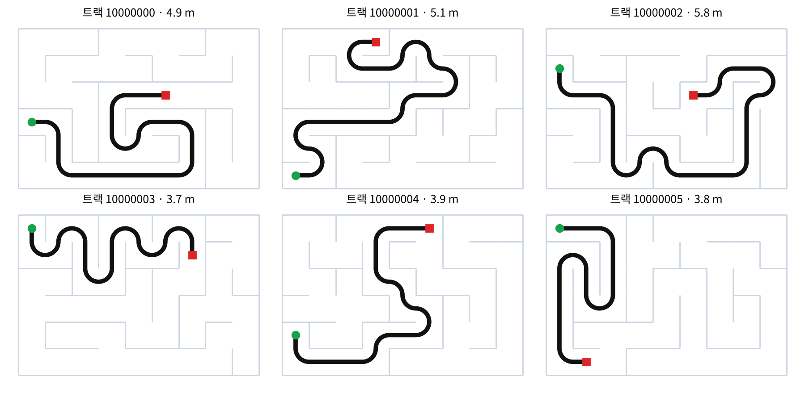
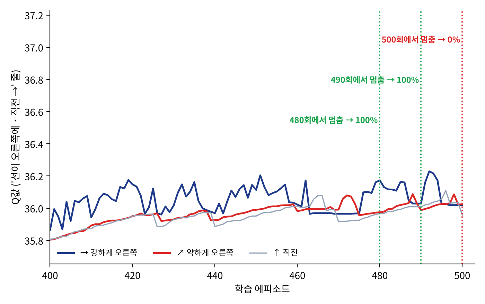
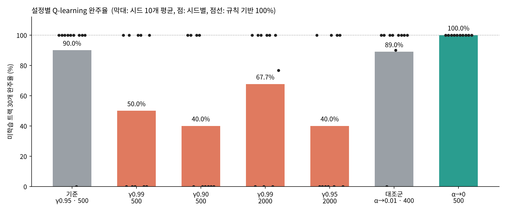

# Why Q-Learning Fails: Instability Analysis on a 2D Line Follower

> **핵심 질문:** 같은 Tabular Q-learning인데, 왜 어떤 시드는 100% 완주하고 어떤 시드는 0%로 무너지는가?

이 프로젝트는 규칙 기반 제어보다 뛰어난 로봇을 만드는 것이 목적이 아닙니다. **규칙 기반 정책이 항상 100% 완주하는 2D 미로 라인트래커에서, Tabular Q-learning이 언제·왜 불안정해지는지를 가설과 대조 실험으로 추적한 기록**입니다.


---

### 핵심 요약
* **현상:** 기준 설정($\gamma=0.95$, 500 에피소드, 시드 10개)에서 9개 시드는 처음 보는 미로 30개를 100% 완주했지만, `seed 7`만 0%로 이탈했습니다.
* **원인 추적:** `seed 7`은 코너 진입 상태의 강하게/약하게 조향 Q값 차이가 **0.004(사실상 동점)**에 불과해 학습 막바지에도 최선 행동(★)이 계속 뒤집혔습니다. 같은 시드도 480·490회에서 멈추면 100%, 499·500회면 0%였습니다.
* **가설 반증 ($\gamma$ · 학습 길이):** 할인율($\gamma$)을 올리거나(0.99) 내리고(0.90), 학습을 2000회까지 늘려도 불안정성은 해결되지 않았으며, 오히려 학습 길이에 따라 $\gamma$ 간 순위가 뒤집혔습니다.
* **대조 실험 ($\alpha$ 스케줄):** 학습률 하한을 0.01에서 0으로 감쇠시키는 대조 실험에서는 시드 10개 모두 100% 완주해, 학습률 스케줄이 불안정성의 주요 축임을 확인했습니다. 다만 400회 강제 동결·전 구간 보폭 축소 혼입·표본 수(10개) 한계가 남아 있어 일반화된 해결책이 아닌 원인 검증 근거로 해석합니다.

---

## 1. 환경 설계 및 평가 기준

규칙 기반 정책은 미로 코스에서 항상 100% 완주하며, "정답이 확실히 존재하는 문제에서도 학습이 불안정할 수 있다"는 기준선(Baseline)으로 사용합니다.

| 항목 | 설정 |
|---|---|
| **로봇** | 2바퀴 차동구동($L=0.10\text{ m}$, 평균 속도 $0.12\text{ m/s}$, $dt=0.05\text{ s}$) + 전방 컬러 센서 2개(반사광 0=검정, 100=흰색) |
| **트랙 (`MazeTrack`)** | 9×6 격자 무작위 DFS 미로 속 한 갈래 길 |
| **상태 (12개)** | (왼쪽 센서: 검정/흰색 · 오른쪽 센서: 검정/흰색 · 직전 조향: 좌/직진/우) → 2 × 2 × 3 = 12가지 |
| **행동 (5개)** | 직진 (60, 60), 약좌 (40, 60), 강좌 (20, 60), 약우 (60, 40), 강우 (60, 20). 각 쌍은 (왼쪽, 오른쪽) 모터 출력 설정값(단위 없음)이며, 바퀴 하나의 출력값 60은 바퀴 속도 0.12 m/s에 해당합니다. |
| **보상 (스텝당)** | 완주 +50점 / 이탈 −20점 / 주행 중 −0.05점 (cost per step), +2 × 중심도 점 (전진 시), −1점 (좌우 조향 즉시 반전 시) |
| **기준 하이퍼파라미터** | $\alpha: 0.1 \to 0.01$ (400회 감쇠), $\gamma: 0.95$, $\varepsilon: 1.0 \to 0.05$ (300회 감쇠) |
| **평가 원칙** | 학습에 쓰지 않은 **처음 보는 트랙 30개**(`seed 10,000,000`~)에서 **탐험을 끄고($\varepsilon=0$)** 시드 10개 평균·분포 측정 |

**보상 설계.** 완주에는 +50점, 이탈에는 −20점을 주어 주행 결과를 구분합니다. 주행 중에는 스텝마다 0.05점을 차감하고, 트랙을 따라 전진한 스텝에는 중심선에 가까울수록 최대 2점을 더합니다. 중심도는 중심선에서 1이며 이탈 경계에 가까워질수록 0까지 선형으로 줄어듭니다. 좌우 조향을 연속된 두 스텝에서 바로 뒤집으면 1점을 차감해 급격한 방향 전환을 줄이도록 유도합니다. 완주·이탈 스텝에는 해당 종료 보상만 적용됩니다.



---

## 2. 실패 해부: 왜 `seed 7`만 0%였는가?

기준 실험($\gamma=0.95$, 500회)에서 유일하게 0%를 기록한 `seed 7`의 Q-table과 평가 주행을 추적한 결과는 다음과 같습니다.

1. **물리적 한계를 넘는 행동 선택:** `seed 7`은 30개 평가 트랙 모두에서 `'선이 오른쪽에 · 직전 →'` 상태일 때 `'약하게 오른쪽'`을 골라 첫 오른쪽 코너에서 이탈했습니다. `'약하게 오른쪽'`의 회전 반경은 $0.25\text{ m}$로, 미로 코너 반지름($0.15\text{ m}$)보다 커서 물리적으로 코너를 돌 수 없습니다.
2. **기억 상태가 실수를 고정:** 선을 놓친 뒤 `'선을 놓침 · 직전 →'` 상태에서 `'약하게 왼쪽'`을 선택하며 직전 조향이 왼쪽으로 바뀌어, 복귀하지 못하고 이탈로 이어졌습니다.
3. **사실상 동점인 Q값과 멈춤 시점 의존성:** 선 위 주행 시 Q값(약 1.9 ÷ (1 − γ))의 대부분이 먼 미래의 누적 보상이어서 행동 간 격차가 극도로 좁습니다. `seed 7`의 해당 상태에서도 강하게/약하게 꺾기의 Q 차이는 **0.004**에 불과했습니다. 평가 시에는 결정적(greedy) 정책만 쓰기 때문에 한 번의 뒤집힘이 30개 트랙 전체의 0%로 직결됐고, 같은 `seed 7`의 완주율은 **480·490회에서 100%, 499·500회에서 0%였습니다.**


4. **숨겨진 사각지대:** 100%를 기록한 `seed 1` 역시 `'선을 놓침 · 직전 →'` 줄은 잘못 학습돼 있었으나, 평가 중 그 상태를 한 번도 방문하지 않아(방문 0회) 결함이 드러나지 않았을 뿐이었습니다.

---

## 3. 가설 검증과 반증

`seed 7`의 동점과 흔들림을 해결하기 위해 두 단계의 가설을 세우고 검증했습니다. 모든 실험은 동일한 미로 환경, 시드 10개, 처음 보는 트랙 30개(규칙 기반 100%)에서 측정했습니다.

### 실험 결과 요약



| 구분 | 설정 | Q 평균 완주율 | 90% 이상 시드 | 평균 진행률 | 흔들림 합계* | 결과 해석 |
|---|---|---:|---:|---:|---:|---|
| 기준 | $\gamma=0.95$, $\alpha \to 0.01$, 500회 | 90.0% | 9 / 10 | 91.3% | 75 | `seed 7`만 0% |
| $\gamma$ 상향 | $\gamma=0.99$, $\alpha \to 0.01$, 500회 | 50.0% | 5 / 10 | 56.6% | 506 | 가설 기각 (악화) |
| $\gamma$ 하향 | $\gamma=0.90$, $\alpha \to 0.01$, 500회 | 40.0% | 4 / 10 | 47.3% | 186 | 악화 |
| 길이 연장 A | $\gamma=0.99$, $\alpha \to 0.01$, 2000회 | 67.7% | 6 / 10 | 72.6% | 133 | 일부 개선되나 불안정 |
| 길이 연장 B | $\gamma=0.95$, $\alpha \to 0.01$, 2000회 | 40.0% | 4 / 10 | 45.0% | 156 | 가설 기각 (순위 역전) |
| 대조군 ($\alpha$ 하한 유지) | $\gamma=0.95$, $\alpha \to 0.01$, 400회 | 89.0% | 9 / 10 | 90.1% | 91 | `seed 3`(0%), `seed 6`(90%) |
| 대조 실험 ($\alpha$ 하한 제거) | $\gamma=0.95$, $\alpha \to 0$, 500회 (400회 동결) | 100.0% | 10 / 10 | 99.4% | 0 (정의상) | 가설 부분 지지 (단서 있음) |

*\* **흔들림 합계:** 상태 `'선이 오른쪽에 · 직전 →'`에서 마지막 100 에피소드 중 최선 행동(★)이 `'강하게 오른쪽'`이 아니었던 횟수의 시드 10개 합계.*\
*\* **평균 진행률 상한:** 완주한 주행도 완주 판정 거리 때문에 99.4%로 기록되며, 규칙 기반도 99.4%입니다.*\
*\* 참고: 별도로 진행한 곡선 코스(`--track curvy`) 실험(98.7%)은 최소 곡률 반지름이 $0.22\text{ m}$로 미로보다 쉬웠고 기존 정책 전이가 아닌 신규 학습이었으므로 비교에서 제외했습니다.*

### 가설 1: 할인율($\gamma$)과 학습 길이 조정 → **기각**
* "할인 때문에 미래 이탈 손해가 덜 반영돼 동점이 생겼다"는 가설로 $\gamma=0.99$를 시도했으나, Q값 스케일이 커지며 500회 안에 자리 잡지 못해 50.0%로 급락했습니다. 반대로 $\gamma=0.90$으로 낮춰도 미래 손해 반영이 약해져 40.0%로 악화됐습니다.
* 학습을 2000회로 늘렸을 때 $\gamma=0.99$는 67.7%로 일부 올랐지만, **기존에 90.0%였던 $\gamma=0.95$는 오히려 40.0%로 떨어지며 $\gamma$ 간 순위가 역전됐습니다**.
* 즉 이 설정에서는 "최적 $\gamma$"가 존재하기보다, **학습률 하한($\alpha=0.01$)과 탐험($\varepsilon=0.05$)이 꺼지지 않은 상태에서 Q값이 수렴하지 않고 출렁여 '언제 멈췄는지'가 성능을 좌우한다**는 가설로 좁혀졌습니다.

### 가설 2: 학습률 하한 제거($\alpha \to 0$) → **부분 지지 (단서 있음)**
* 400 에피소드에 걸쳐 $\alpha$를 0까지 감쇠시키자 시드 10개 모두 100% 완주했고, 같은 400회 시점에서 기존 하한($\alpha \to 0.01$)을 유지한 대조군은 89%(실패 시드 `seed 3` 0%, `seed 6` 90%)에 그쳤습니다.
* 다만 이 결과를 "범용적인 수렴 달성"으로 과대해석해서는 안 됩니다.
  1. **변수 혼입:** $\alpha_{\text{end}}=0$은 400회 이후의 업데이트를 멈출 뿐 아니라 0~400회 전 구간에서 $\alpha$를 더 빠르게 줄입니다. 개선이 "후반 동결" 때문인지 "전반적인 분산 감소" 때문인지 이 실험만으로는 분리되지 않습니다.
  2. **고정 타이머의 한계:** 400회 강제 동결은 이 미로 난이도에 우연히 맞았을 뿐, 더 복잡한 환경에서는 학습이 덜 끝난 상태로 영구 고착될 위험이 있습니다.

---

## 4. 한계점 및 공학적 시사점

### 프로젝트의 한계
* **부분 관측(POMDP)과 사각지대:** 12개 이산 상태는 선 중심 오차의 크기나 코너 곡률을 표현하지 못하며, 방문 0회 상태의 잘못된 정책을 걸러내지 못합니다.
* **감시 지표의 사각지대:** 흔들림 지표가 한 개 상태 줄만 추적합니다. 실제로 감시 줄의 ★가 `'강하게 오른쪽'`으로 정상인데도 0%가 나온 시드가 $\gamma=0.99$·500회(`seed 2`), $\gamma=0.90$(`seed 7`), $\gamma=0.99$·2000회(`seed 2·8`), $\gamma=0.95$·2000회(`seed 2`), 400회 대조군(`seed 3`)에 있어, 다른 상태 줄의 붕괴를 자동 포착하지 못했습니다.
* **표본과 보상 편향:** 시드 10개는 실패 확률을 통계적으로 확정하기에 적으며, 현재 보상 가중치는 $\gamma=0.95$ 기준으로 조정돼 다른 $\gamma$에 불리했을 가능성이 있습니다.
* **환경 단순화:** 갈림길이 없는 단일 경로이며, 센서 잡음·모터 관성·미끄러짐이 없는 이상적 시뮬레이션입니다.

### 현업 제어·자율주행으로의 연결
이 작은 실험은 **"단순 Tabular Q-learning을 그대로 실전 제어에 쓰기 어려운 이유"**를 압축해서 보여줍니다.
* **왜 고전 제어가 여전히 쓰이는가:** 정답이 존재하는 단순 주행에서도 순수 RL은 시드와 멈춤 시점에 따라 갑자기 0%로 무너질 수 있고, 안전성을 수학적으로 보증하기 어렵습니다. 산업 현장과 로봇 제어에서 **PID·FSM·MPC** 같은 고전 방법이 여전히 기본 축으로 쓰이는 이유입니다.
* **실무 RL의 보완 방향:** 강화학습을 범용화하려면 고정 에피소드 감쇠 대신 상태-행동 방문 횟수 기반 학습률 $\alpha(s,a)$, 과대추정을 줄이는 Double Q-learning/Expected SARSA, 연속 상태를 다루는 함수 근사(Deep RL), 그리고 최종 평가와 분리된 **검증 환경 기반 베스트 체크포인트 선택**이 필수적입니다.
* **자율주행에서의 해법:** 실제 도로 주행도 바닥부터 시행착오로 배우는 순수 RL에 맡기기보다, 인지는 대규모 데이터 기반 지도학습·모방학습으로, 판단·제어는 규칙(FSM)과 최적 제어(MPC) 같은 검증 가능한 방법으로 나누어 불확실성을 통제하는 구성이 주류입니다 (Tang et al., 2024, arXiv:2408.03539; Aksjonov & Kyrki, 2022, arXiv:2201.12819).

---

## 5. 실행 방법 및 구조

Python 3.10 이상 환경에서 프로젝트 루트 기준으로 실행합니다.

```sh
# 1. 의존성 설치 및 단위 테스트 (전체 26개 테스트)
python -m pip install -r requirements.txt
python -m unittest discover -s tests -v

# 2. 실시간 Q-learning 대시보드 실행 (기본: 미로 코스)
python dashboard.py

# 3. 다중 시드 학습 및 미학습 트랙 30개 검증 (결과는 runs/<exp>/ 저장)
python verify.py --exp baseline-g095 --gamma 0.95 --episodes 500 --seeds 1 2 3 4 5 6 7 8 9 10

# 4. 저장된 Q-table 불러와 평가 모드로 관찰 (이탈 시 자동 정지)
python dashboard.py --seed 7 --load runs/baseline-g095/q_seed7.npy

# 5. 기존 규칙 기반 원형 트랙 데모
python main.py
```

### 주요 파일 역할

| 파일 | 역할 |
|---|---|
| `line_follower/random_track.py` | `MazeTrack`(9×6 DFS 미로) 및 `RandomTrack`(부드러운 곡선) 생성 |
| `line_follower/rl_env.py` | 12상태·5행동·보상·이탈/완주 조건을 정의한 RL 환경 |
| `line_follower/qlearning.py` | Tabular `QAgent`, 규칙 기반 기준선(`rule_policy`), 평가 함수 |
| `verify.py` | 테스트 실행 → 다중 시드 병렬 학습 → 미학습 트랙 30개 평가 및 지표 저장 |
| `dashboard.py` | 2D 주행·센서 LED·실시간 Q-table·학습 지표 시각화 대시보드 |
| `train.py` | GUI 없이 단일 시드 학습 후 `q_table.npy` 및 로그 저장 |
| `main.py` | 기존 원형 트랙 규칙 기반 시뮬레이터 |